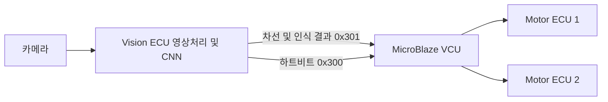

# ADAS CAN 및 ECU 구조

## 담당 범위

CAN RTL, AXI4-Lite 레지스터 맵, C 함수 인터페이스와 인식 결과 통신 연동을 중심으로 참여했습니다. 저장소에는 시스템 연결 관계를 이해하기 위한 팀 전체의 VCU·Motor·Vision 코드도 포함됩니다. CNN 모델, Motor ECU 및 Safety Domain 전체를 개인 단독 성과로 의미하지 않습니다.

## CAN 하드웨어와 소프트웨어

| 오프셋 | 레지스터 | 역할 |
|---|---|---|
| 0x00 | CAN_BTR | BRP/TSEG1/TSEG2/SJW |
| 0x04 | CAN_CR | 송신 요청 및 소프트웨어 리셋 |
| 0x08 | CAN_SR | READY/RX 인터럽트/오류/Bus-Off 상태 |
| 0x0C | CAN_TX_MAILBOX | 표준 ID, DLC, IDE/RTR |
| 0x10, 0x14 | CAN_TX_DATA0/1 | 송신 데이터 8바이트 |
| 0x18 | CAN_RX_MAILBOX | 수신 프레임 정보 |
| 0x1C, 0x20 | CAN_RX_DATA0/1 | 수신 데이터 8바이트 |

제어 레지스터 쓰기는 송신 요청 또는 리셋 펄스로 변환됩니다. 수신 완료는 하드웨어 메일박스를 갱신하고 RX 상태를 유지하며, 소프트웨어가 상태 비트에 1을 써서 해제합니다. VCU 드라이버의 소프트웨어 큐와 하드웨어 메일박스는 별개의 계층입니다.

`firmware/vision/app/adas_can_app.h`는 결과 프레임의 필드와 ID를, `firmware/vision/hal/can_hw.c`는 실제 사용되는 CAN 접근을 설명합니다. VCU의 `driver/can/can.c`에는 수신 콜백·큐·메시지 해석·송신 처리가 나뉘어 있습니다.

## 확인 범위

Vision ECU는 사용자가 지정한 `visionecu1013` 소스입니다. VCU는 활성 `ADAS/PROJECTS/vcu` 및 `ADAS/PROJECTS/vitis/vcu_app` 트리입니다. 두 트리의 CAN RTL이 같은 개정판이라는 전제는 두지 않습니다. 각 보드에 대응하는 소스를 사용해야 합니다.

소스에 없는 CAN 필터 API, 하드웨어 RX FIFO, 황색 신호등 인식 또는 IMU/FIR의 통합 성공은 이 문서의 성과로 추가하지 않았습니다.
